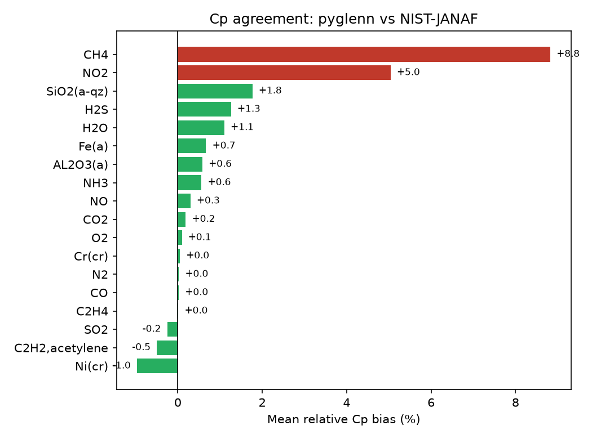
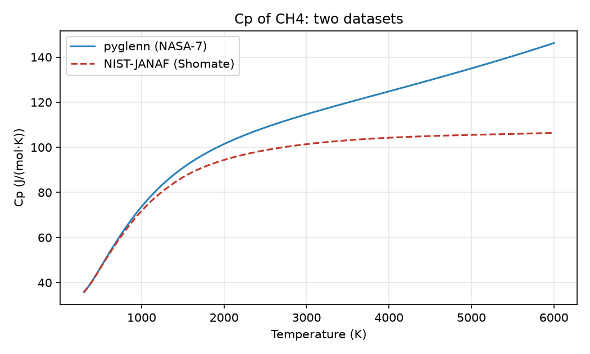
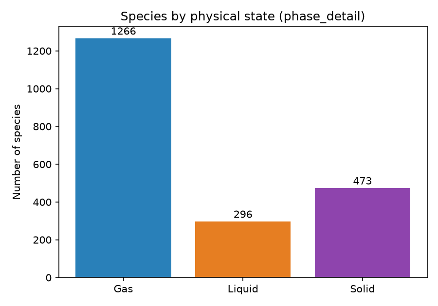

# pyglenn 0.5.0: per-species uncertainty, in numbers

Version 0.5.0 of pyglenn answers two questions that had been left open. How
much can I trust the heat capacity of a given species? And how do I separate
a solid from a liquid, given that both were grouped under "condensed"?

Both answers arrive together in this release. The first is a per-species
error budget, validated against the NIST-JANAF tables. The second is a new
field called `phase_detail`, which distinguishes gas, liquid and solid.

## Where the numbers agree, and where they diverge

To measure confidence, we compared 18 representative species from the
database with the NIST-JANAF tables, an independent reference. The chart
below shows the mean difference in heat capacity (Cp) for each one, as a
percentage.



Most species stay within 1%, an excellent agreement between two independent
datasets. Methane (CH4) and nitrogen dioxide (NO2) stand out, but only at
high temperature. The next chart shows the methane case in detail.



The two curves track each other up to about 1500 K and separate after that.
The gap is not an error on one side alone. It follows from two different
polynomial fits for a molecule that, in this temperature range, would already
be dissociated. Above 3000 K both values are extrapolations, and each source
extrapolates in its own way.

For the other 2,017 species, which do not appear in the NIST tables, pyglenn
extends the budget by class (gas or condensed). The estimate is available
through the API, together with an indication of where it came from:

```python
calc.uncertainty(species_id, 1000.0)
# {'cp_rel_bias': 8.82, 'cp_rel_2sigma': 27.61, ..., 'source': 'nist-janaf'}
```

The `source` field is `nist-janaf` for validated species and `extrapolated`
for the rest.

## Solids and liquids, separated

The second change is simpler to explain. Before, every non-gaseous species
received the single label `condensed`. Now the `phase_detail` field
classifies each one as `gas`, `liquid` or `solid`.



Of the 2,035 species in the database, 1,266 are gaseous, 473 are solid and
296 are liquid. Filtering by physical state becomes a short call:

```python
calc.get_available_species(phase_detail='solid')
```

The classification comes from the species name in the NASA CEA database,
where the `(L)` marker indicates a liquid. The old `phase` field remains, so
existing pyglenn users are not affected.

## What changes in day-to-day use

The two changes make pyglenn more transparent. You now know the order of
magnitude of the error behind each number, and you can select species by
physical state without relying on the name. All of this ships inside the
package database, with no extra setup step.
