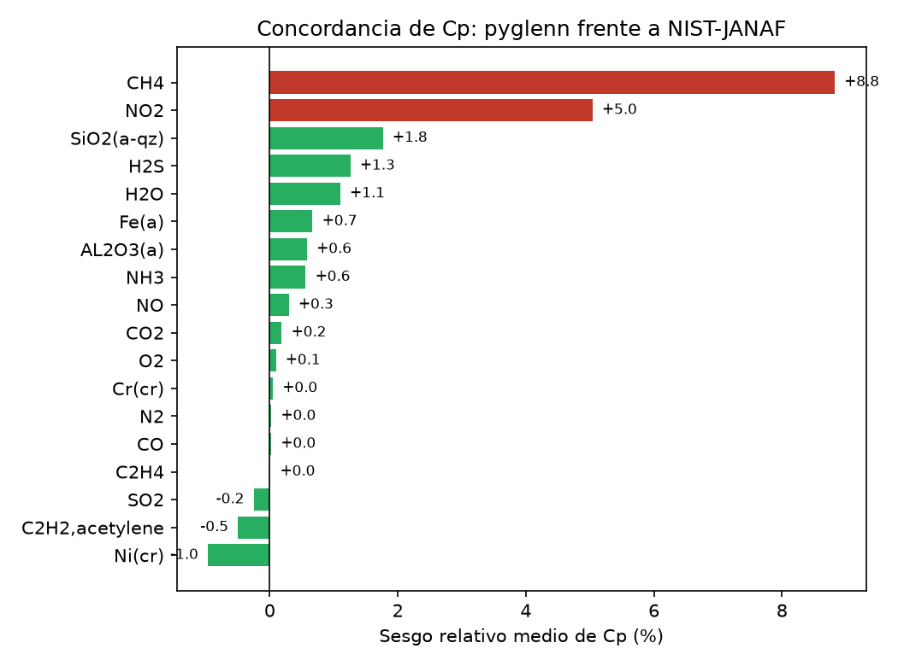
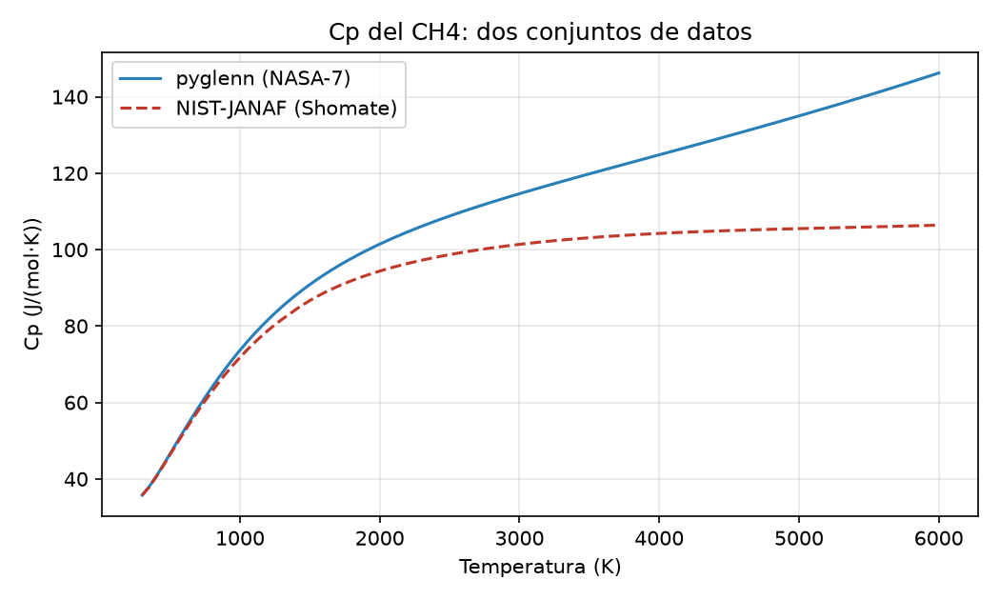
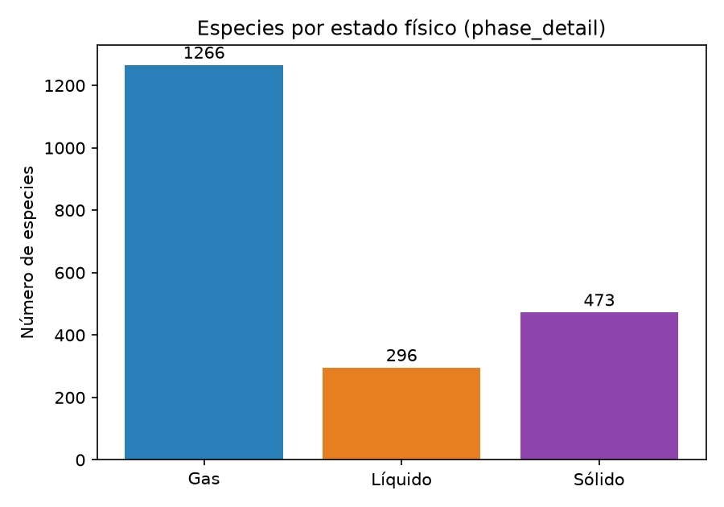

# pyglenn 0.5.0: la incertidumbre de cada especie, en cifras

La versión 0.5.0 de pyglenn responde a dos preguntas que hasta ahora
quedaban sin respuesta. ¿Cuánto puedo confiar en el calor específico de una
especie? ¿Y cómo separo un sólido de un líquido, si ambos quedaban agrupados
como "condensed"?

Las dos respuestas llegan juntas en esta versión. La primera es un
presupuesto de error por especie, validado frente a las tablas NIST-JANAF.
La segunda es un campo nuevo, llamado `phase_detail`, que distingue gas,
líquido y sólido.

## Dónde los números coinciden y dónde divergen

Para medir la confianza, comparamos 18 especies representativas de la base
con las tablas NIST-JANAF, una referencia independiente. El gráfico de abajo
muestra la diferencia media en el calor específico (Cp) de cada una, en
porcentaje.



La mayoría de las especies se mantiene dentro del 1%, un acuerdo excelente
entre dos conjuntos de datos independientes. El metano (CH4) y el dióxido de
nitrógeno (NO2) se apartan, pero solo a alta temperatura. El gráfico
siguiente muestra el caso del metano en detalle.



Las dos curvas avanzan juntas hasta unos 1500 K y se separan después. La
separación no es un error de un solo lado. Es la consecuencia de dos ajustes
polinomiales distintos para una molécula que, en ese rango de temperatura, ya
estaría disociada. Por encima de 3000 K ambos valores son extrapolaciones, y
cada fuente extrapola a su manera.

Para las otras 2.017 especies, que no aparecen en las tablas NIST, pyglenn
extiende el presupuesto por clase (gas o condensado). La estimación queda
disponible en la API, junto con la indicación de su origen:

```python
calc.uncertainty(species_id, 1000.0)
# {'cp_rel_bias': 8.82, 'cp_rel_2sigma': 27.61, ..., 'source': 'nist-janaf'}
```

El campo `source` vale `nist-janaf` para las especies validadas y
`extrapolated` para las demás.

## Sólido y líquido, separados

La segunda novedad es más sencilla de explicar. Antes, toda especie no
gaseosa recibía la etiqueta única `condensed`. Ahora el campo `phase_detail`
clasifica cada una como `gas`, `liquid` o `solid`.



De las 2.035 especies de la base, 1.266 son gaseosas, 473 son sólidas y 296
son líquidas. Filtrar por estado físico se reduce a una llamada corta:

```python
calc.get_available_species(phase_detail='solid')
```

La clasificación proviene del nombre de la especie en la base NASA CEA, donde
la marca `(L)` indica líquido. El campo `phase` anterior se mantiene, para no
afectar a quienes ya usaban pyglenn.

## Qué cambia en el uso diario

Los dos cambios hacen a pyglenn más transparente. Ahora conoces el orden de
magnitud del error detrás de cada número y puedes seleccionar especies por su
estado físico sin depender del nombre. Todo esto viene en la base de datos
distribuida con el paquete, sin pasos adicionales de configuración.
