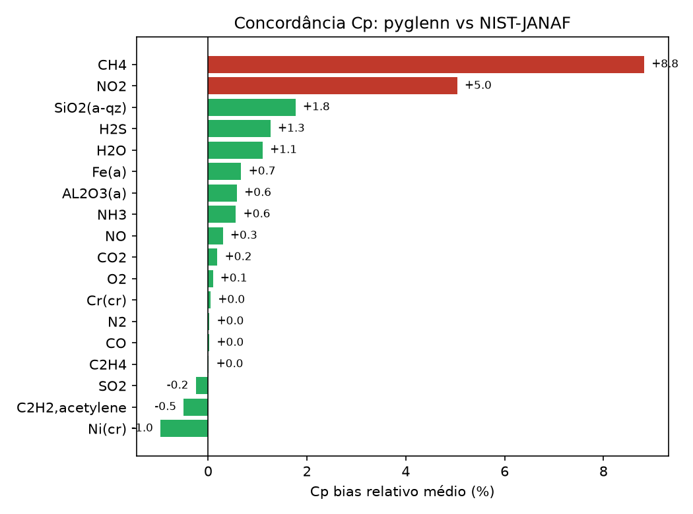
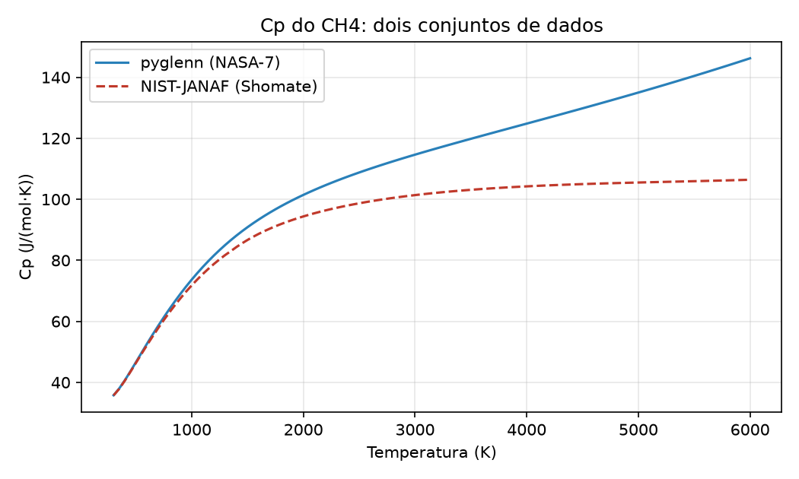
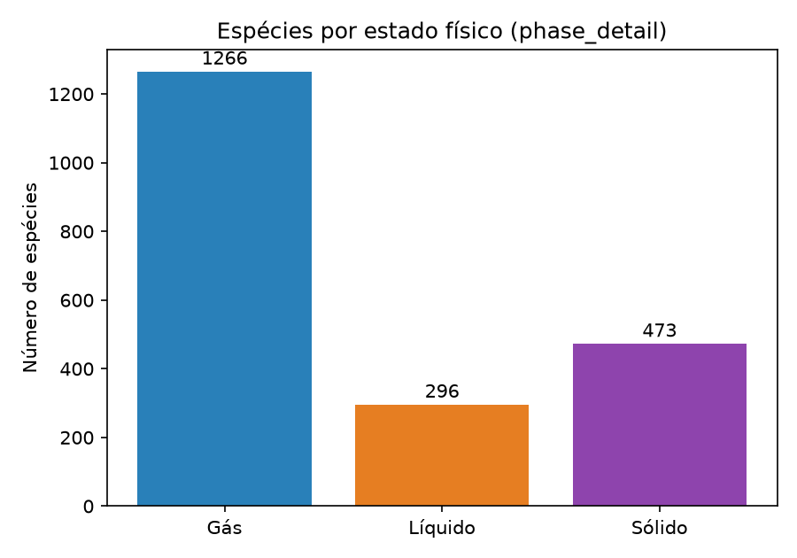

# pyglenn 0.5.0: a incerteza de cada espécie, em números

A versão 0.5.0 do pyglenn responde a duas perguntas que até agora ficavam sem
resposta. Quanto eu posso confiar no calor específico de uma espécie? E como
eu separo um sólido de um líquido, já que os dois eram agrupados como
"condensed"?

As duas respostas chegam juntas nesta versão. A primeira é um orçamento de
erro por espécie, validado contra as tabelas NIST-JANAF. A segunda é um campo
novo, chamado `phase_detail`, que distingue gás, líquido e sólido.

## Onde os números concordam e onde divergem

Para medir a confiança, comparamos 18 espécies representativas do banco com
as tabelas NIST-JANAF, uma referência independente. O gráfico abaixo mostra a
diferença média no calor específico (Cp) de cada uma, em porcentagem.



A maioria das espécies fica dentro de 1%, o que é um acordo excelente entre
dois conjuntos de dados independentes. Metano (CH4) e dióxido de nitrogênio
(NO2) destoam, mas só em alta temperatura. O gráfico seguinte mostra o caso do
metano em detalhe.



As duas curvas andam juntas até uns 1500 K e se separam depois disso. Essa
abertura não é erro de um lado apenas. É a consequência de dois ajustes
polinomiais distintos para uma molécula que, nessa faixa de temperatura, já
estaria dissociada. Acima de 3000 K os dois valores são extrapolações, e cada
fonte extrapola de um jeito.

Para as outras 2.017 espécies, que não aparecem nas tabelas NIST, o pyglenn
estende o orçamento por classe (gás ou condensado). A estimativa fica
disponível na API, junto com a indicação de onde ela veio:

```python
calc.uncertainty(species_id, 1000.0)
# {'cp_rel_bias': 8.82, 'cp_rel_2sigma': 27.61, ..., 'source': 'nist-janaf'}
```

O campo `source` vale `nist-janaf` para as espécies validadas e
`extrapolated` para as demais.

## Sólido e líquido, separados

A segunda novidade é mais simples de explicar. Antes, toda espécie não gasosa
recebia o rótulo único `condensed`. Agora o campo `phase_detail` classifica
cada uma como `gas`, `liquid` ou `solid`.



Das 2.035 espécies do banco, 1.266 são gasosas, 473 são sólidas e 296 são
líquidas. Filtrar por estado físico vira uma chamada curta:

```python
calc.get_available_species(phase_detail='solid')
```

A classificação vem do nome da espécie na base NASA CEA, onde a marca `(L)`
indica líquido. O campo `phase` antigo continua existindo, para não quebrar
quem já usava o pyglenn.

## O que isso muda no dia a dia

As duas mudanças deixam o pyglenn mais transparente. Você passa a saber a
ordem de grandeza do erro de cada número e consegue selecionar espécies pelo
estado físico sem depender do nome. Tudo isso já vem no banco de dados
distribuído com o pacote, sem nenhuma etapa extra de configuração.
